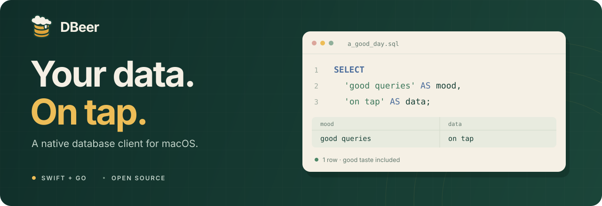
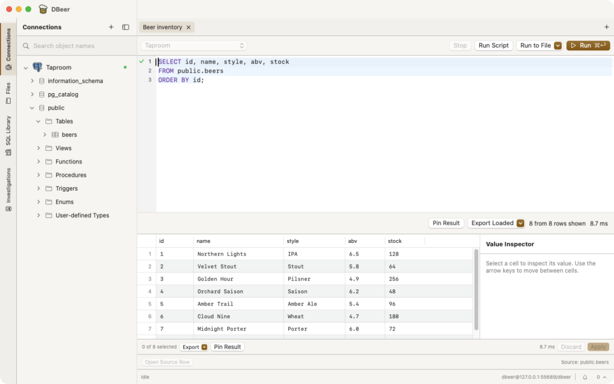
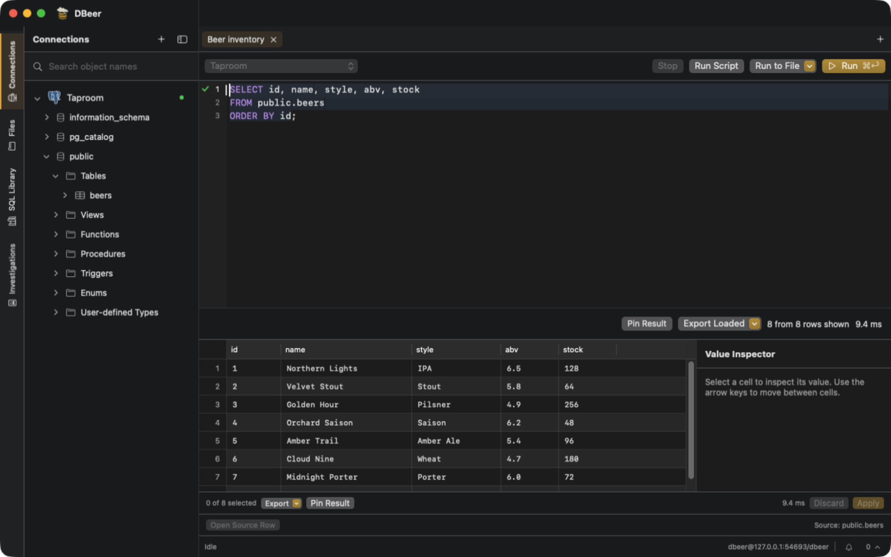

<h1 align="center">DBeer</h1>

<p align="center">
  
</p>

<p align="center">
  <strong>PostgreSQL. MySQL. Cassandra. MongoDB. One native macOS app.</strong><br>
  Built with SwiftUI, AppKit and Go. Brewed for your daily database work.
</p>

<p align="center">
  <a href="INSTALL.md"></a>
  <a href="INSTALL.md"></a>
  <a href="#build-it-yourself"></a>
  <a href="LICENSE"></a>
</p>

<p align="center">
  <a href="https://github.com/nullawhale/dbeer/releases/tag/v0.4.0"><strong>Download for Mac ↗</strong></a>
  &nbsp;·&nbsp;
  <a href="#quick-start">Quick start</a>
  &nbsp;·&nbsp;
  <a href="#pick-your-pour">Screenshots</a>
  &nbsp;·&nbsp;
  <a href="GUIDE.md">User guide</a>
  &nbsp;·&nbsp;
  <a href="CHANGELOG.md">Changelog</a>
  &nbsp;·&nbsp;
  <a href="https://github.com/nullawhale/dbeer/issues">Report an issue</a>
</p>

---

## Your new query companion 🍺

Write queries, browse tables, review changes and keep your investigations together.
DBeer brings a native editor and a persistent workspace to the databases you use
every day, with independent sessions for each SQL tab.

| The good stuff | What you get |
| :--- | :--- |
| **An editor that gets you** | Contextual completion, multiple cursors, find/replace, offline formatting and code folding. |
| **Tabs with their own space** | Each SQL tab keeps its connection, transaction, session settings and temporary tables until disconnected. |
| **Edits you can review** | Stage cell changes, inspect **Preview SQL**, then **Apply**. Conflicts roll back the batch. |
| **A workspace worth keeping** | Split panes, SQL files, a shared query library, result snapshots and investigation documents. Unreleased: saved structure and diagnostic evidence. |
| **Unreleased schema maps** | PostgreSQL/MySQL/SQLite ER diagrams combine saved profiles with independent metadata loads, explicit rebinding, shared reviewed structure drafts and owned exports. |
| **Data on the move** | Copy cells and ranges, export loaded results, or use **Run to File** for a complete export. |
| **A look that fits** | System appearance, light **Lager**, dark **Porter**, and importable editor color schemes. |

### Bring your agents

Local MCP access lets agents work through the connections you explicitly approve.
Access starts read-only; writes require a separate grant. Manage or revoke access
in **Settings → Agents**. [Setup and limits →](GUIDE.md#local-mcp-agent-access)

## Pick your pour

Lager for daylight. Porter for late-night queries.
Real captures of the native macOS development build with demo PostgreSQL data.

### Lager · light



### Porter · dark



## Pick your database

| Database | Supported versions | Query language |
| :--- | :--- | :--- |
| **PostgreSQL** | 16 / 17 / 18 | SQL |
| **MySQL** | 8.0 / 8.4 | SQL |
| **MariaDB** | 10.11.9+ / 11.4.3+ · **unreleased, partial** | SQL |
| **Apache Cassandra** | 4.1 / 5.0 | CQL |
| **MongoDB** | 8.0 | JSON find / aggregation requests |
| **SQLite** | Local files · **unreleased** | SQL |

MariaDB is a separate adapter in the unreleased build, not a MySQL alias. It
supports native SQL sessions, TLS/SSH, table-grid editing/import, Explain/Analyze,
monitoring, reviewed tuning, guarded schema/data comparisons and transfer, native
SQL backup/restore, and ordinary V1/V2/V3 table authoring. SQL-result
editing, generated/AUTO_INCREMENT authoring, backfill/reconstruction, destructive
conversion, multi-table migrations, advanced-table authoring and physical
partition/storage operations remain disabled or manual. See
[MariaDB scope and requirements](GUIDE.md#mariadb-partial-support).

The packaged macOS release is **0.4.0 · build 13**. SQLite and other work in
progress are documented in the [guide](GUIDE.md) and
[Unreleased changelog](CHANGELOG.md#unreleased).

## Quick start

1. **Grab a fresh build.** Download the ZIP and SHA256 from
   [GitHub Releases](https://github.com/nullawhale/dbeer/releases/tag/v0.4.0),
   verify the checksum, and move `DBeer.app` into **Applications**.
   See the [installation guide](INSTALL.md) for the exact steps.
2. **Make a connection.** Press **⌘N**, choose your database and enter its details.
   Passwords go into macOS Keychain; SSH tunnels and TLS are supported.
3. **Run something good.** For PostgreSQL or MySQL, open a SQL tab with **⌘T**,
   paste the query below, and press **⌘Return**.

```sql
SELECT 'good queries' AS mood, 'on tap' AS data;
```

Requires **macOS 14+ and Apple Silicon**. The packaged app includes its Go helper;
Go and Swift are only needed to build from source. Homebrew installation is not
available. Builds use an Apple Development signature and are not notarized;
see [installation and macOS opening instructions](INSTALL.md).

### Keep your hands on the keyboard

| Shortcut | Action |
| :--- | :--- |
| **⌘N** / **⌘T** | New connection / new SQL tab |
| **⌘Return** | Run the selection or current statement |
| **⇧⌘Return** | Run the entire script |
| **⌃Space** | Open completion suggestions |
| **⌘F** | Find in the editor; loaded-grid search is unreleased |
| **⌘O** / **⌘S** | Open / save a SQL file |
| **⌘1** … **⌘4** | Toggle Connections, Files, SQL Library or Investigations |
| **⌘,** | Open settings |

## The details matter

- **Preview before Apply.** Grid changes stay local until you apply the reviewed
  batch. An uncertain commit blocks another Apply until its outcome is checked.
- **Your values stay distinct.** SQL `NULL`, empty strings, the text `NULL` and
  `DEFAULT` retain their meaning. Exact numeric strings and binary values keep
  their representations in transport and exports.
- **Restore on your terms.** Reopening a workspace never connects to a database
  or executes a query. Exported connection profiles exclude passwords and private keys.

Read the [execution and safety guide](GUIDE.md#execution-commands-and-safety)
for read-only policies, production confirmations and their limits.

## Go a little deeper

| I want to… | Start here |
| :--- | :--- |
| Install or update DBeer | [Installation](INSTALL.md) |
| Explore the app | [Using the application](GUIDE.md#using-the-application) |
| Tune my queries | [Editor tools](GUIDE.md#editor-tools) · [Completion](GUIDE.md#sql-editor-and-completion) |
| Browse and edit data | [Saved table views](GUIDE.md#table-filters-sorting-and-saved-views) · [Result editing](GUIDE.md#sql-result-source-rows-and-editing) |
| Compare live and saved schemas | [Schema bundles](GUIDE.md#schema-bundles-for-git) · [Schema comparison](GUIDE.md#schema-comparison) |
| Keep research together | [Investigations](GUIDE.md#investigation-documents) · [Snapshots](GUIDE.md#result-snapshot-storage) |
| Connect securely | [SSH tunnels](GUIDE.md#ssh-tunnels) · [Dynamic passwords](GUIDE.md#dynamic-database-passwords) |
| See what's new | [Changelog](CHANGELOG.md) · [Releases](https://github.com/nullawhale/dbeer/releases) |

The [full guide](GUIDE.md) follows the current source tree and includes unreleased
features; check the changelog for what ships in each release.

## Build it yourself

You'll need macOS 14+ on Apple Silicon, **Swift 6**, the Go version in
[`helper/go.mod`](helper/go.mod), and a persistent **Apple Development** signing
identity. Command Line Tools are enough for normal builds.

```sh
git clone https://github.com/nullawhale/dbeer.git
cd dbeer
./scripts/build-app.sh
```

The app lands in `build/DBeer.app`. For a debug build, use
`CONFIGURATION=debug ./scripts/build-app.sh`.
[Build and signing details →](GUIDE.md#building)

For focused checks without UI verification:

```sh
./scripts/test-go.sh
./scripts/test.sh --filter SQLScriptParserTests
```

See the [verification guide](GUIDE.md#verification) for database integration,
explicitly requested UI checks and full-suite runs.

### Find your way around

| Path | What's inside |
| :--- | :--- |
| [`macos/Sources/DBeer/`](macos/Sources/DBeer/) | Native SwiftUI/AppKit app |
| [`helper/`](helper/) | Go helper, database adapters and transport |
| [`protocol/fixtures/`](protocol/fixtures/) | Shared protocol and export fixtures |
| [`scripts/`](scripts/) | Build, test and release entry points |
| [`prototypes/gpui/`](prototypes/gpui/) | Experimental Windows/Linux frontend |

## Pull up a chair

Found a bug or have an idea? [Open an issue](https://github.com/nullawhale/dbeer/issues).
Contributions are welcome; read [AGENTS.md](AGENTS.md) for project conventions
and verification scope.

Current development focuses on the native macOS client and shared Go helper.
Windows/Linux contributions are welcome in the experimental
[GPUI client](prototypes/gpui/README.md), which is outside the current macOS release scope.

---

<p align="center">
  <strong>Good queries. Great taste.</strong><br>
  Open source under <a href="LICENSE">GPL-3.0-only</a> · Distributed without warranty.<br>
  Third-party code and resources retain their respective licenses and notices.
</p>
